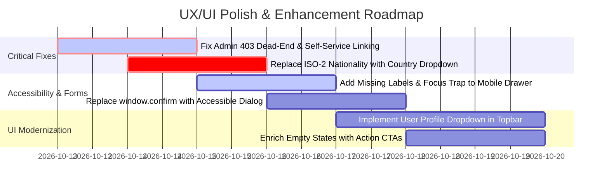

# Quality Assurance Audit: User Experience (UX) & User Interface (UI)
**Application:** S3curity H3LIX Enterprise Human Capital Management (Dev)  
**Target URL:** `https://hrms-dev.s3curity.net/`  
**Audited Account:** `cedi` (Cedric Regis JR — Super Administrator)  
**Audit Date:** October 12, 2026  
**Audited Scope:** 28 Portal Views, Authentication, Design System (`helix.css`), Client Behavior (`helix.js`), WCAG 2.1 AA Compliance, Mobile Responsiveness, and Information Architecture.

---

## 1. Executive Summary

A comprehensive UX/UI Quality Assurance audit was conducted on the **S3curity H3LIX** platform. H3LIX features a cohesive dark cybersecurity-inspired aesthetic (deep navy `--hx-navy: #081522` with vibrant cyan/teal accents), semantic HTML5 structure, and clean vanilla ES6 scripting.

While the foundational design system and visual hierarchy are strong, our audit identified **2 Critical Usability Blockers**, **4 Major Experience Friction Points**, **3 Accessibility (WCAG) Deficiencies**, and several **Visual Polish Opportunities**.

```
Overall UX/UI Score: 81 / 100
├── Visual Design & Consistency:   90 / 100  (Excellent dark theme, typography & branding)
├── Information Architecture:      82 / 100  (Clear hierarchy; dead-end links present)
├── Forms & Data Entry:            74 / 100  (Manual ISO codes, missing inline format validation)
├── Responsiveness & Mobile:       79 / 100  (Solid breakpoints; focus trapping & mobile tables need work)
└── Accessibility (WCAG 2.1 AA):   80 / 100  (Good contrast; some missing aria attributes & labels)
```

---

## 2. Critical & Major Issues Summary

| ID | Severity | Module / View | Issue Summary | Impact |
| :--- | :---: | :--- | :--- | :--- |
| **UX-01** | **CRITICAL** | Navigation & Self-Service (`/me/*`) | **403 Dead-End for Unlinked Admin Accounts**: Clicking self-service links produces an unhandled HTTP 403 error page. | High frustration; broken user journey. |
| **UX-02** | **CRITICAL** | Employee Management (`/employees/create`) | **Manual ISO-2 Nationality Input**: Users must manually enter 2-letter ISO country codes instead of a searchable country picker. | High error rate; data integrity issues. |
| **UX-03** | **MAJOR** | Forms & Actions (`helix.js`) | **Native Browser Dialogs for Destructive Actions**: `window.confirm()` halts browser thread and lacks styling/accessibility. | Inconsistent UX across operating systems. |
| **UX-04** | **MAJOR** | Topbar Utility Header | **Absence of User Profile Dropdown**: Utility links (MFA, language, logout) clutter header without user avatar context. | Cluttered interface, lack of personal profile anchor. |
| **UX-05** | **MAJOR** | Empty States (`/leave`, `/attendance`, `/approvals`) | **Passive Empty States without Primary CTAs**: Explanatory text exists, but no immediate action button is provided inside the card. | Decreased task completion speed. |
| **A11Y-01**| **MAJOR** | Checkbox & Toggle Inputs | **Missing `<label>` association** on checkboxes in Attendance, Recruitment, and Training. | Screen reader failure; WCAG 3.3.2 violation. |

---

## 3. Deep Dive Findings & Detailed Analysis

### Issue UX-01: Orphan Administrator Self-Service Dead-End (HTTP 403)
* **Location:** Sidebar Navigation `Me` group (`/me`, `/me/documents`, `/me/onboarding`, `/me/performance`, `/me/training`, `/me/policies`, `/me/assets`)
* **What Happens:** The navigation displays 10 self-service options. However, when user `cedi` (a Super Administrator) clicks 7 of these links, the server returns:
  > *"403 · Your account is not linked to an employee record. Ask your administrator to link it. Return to dashboard"*
* **Why It Is Bad UX:**
  1. The user *is* the Super Administrator, so telling them to "Ask your administrator" is confusing.
  2. The navigation promises pages that immediately fail.
* **Recommended Fix:**
  - **Option A (Preferred):** If the logged-in user has no linked employee profile, either hide the `Me` self-service section or render a clear badge `(Not Linked)`.
  - **Option B:** Replace the raw 403 page with an in-app prompt offering a 1-click action: *"Link your admin account to an employee record"*.

---

### Issue UX-02: Employee Creation Nationality Input (`f_nationality`)
* **Location:** `/employees/create` (Add Employee Form)
* **What Happens:** The nationality field is rendered as:
  ```html
  <label class="hx-label" for="f_nationality">Nationality (ISO 2)</label>
  <input class="hx-input" type="text" id="f_nationality" name="nationality" maxlength="2" value="QA">
  ```
* **Why It Is Bad UX:**
  - Expecting HR personnel to memorize ISO 3166-1 alpha-2 codes (e.g., `PH`, `IN`, `QA`, `NP`, `EG`, `GB`) causes typing errors.
  - Typing "Qatar" truncates to "Qa", resulting in invalid submissions.
* **Recommended Fix:**
  - Replace with a searchable `<select>` or autocomplete combobox containing full country names and flag icons (e.g., `🇶🇦 Qatar (QA)`).

---

### Issue UX-03: Destructive Actions using Native `window.confirm()`
* **Location:** Global application behavior (`helix.js` line 44)
  ```javascript
  document.addEventListener('click', (event) => {
    const el = event.target.closest('[data-hx-confirm]');
    if (el && !window.confirm(el.dataset.hxConfirm)) {
      event.preventDefault();
      event.stopImmediatePropagation();
    }
  }, true);
  ```
* **Why It Is Bad UX:**
  - Native browser popups freeze background rendering.
  - Inconsistent visual styling across Windows, macOS, Android, and iOS.
  - Cannot be customized with "Danger / Caution" branding or detailed explanatory copy.
* **Recommended Fix:**
  - Replace native `window.confirm` with a stylized, accessible `<dialog>` modal with explicit "Confirm" (danger red/cyan) and "Cancel" buttons.

---

### Issue UX-04: Header Layout & Profile Dropdown
* **Location:** Global Top Bar (`<header class="hx-topbar">`)
* **What Happens:** The header places multiple flat ghost buttons in a row:
  - `[العربية]` (Language)
  - `[🔔]` (Notifications)
  - `[Set up two-factor authentication]`
  - `[Sign out]`
* **Why It Is Bad UX:**
  - No user avatar or name display in the top-right header, making it unclear at a glance who is currently signed in.
  - Security configuration (`Set up two-factor authentication`) consumes large horizontal space on tablet and laptop screens.
* **Recommended Fix:**
  - Introduce a unified **User Profile Menu**:
    ```
    [ 👤 Cedric Regis JR ▾ ]
    ├── Role: Super Administrator
    ├── 🛡️ Two-Factor Authentication (Off)
    ├── 🌐 Language (English / العربية)
    └── 🚪 Sign Out
    ```

---

### Issue UX-05: Empty States Missing Direct Call-to-Action
* **Location:** `/leave`, `/attendance`, `/approvals`, `/assets`, `/compliance`
* **What Happens:**
  When tables have 0 records, the page shows:
  > *"No leave requests. Requests submitted by employees or by HR on their behalf appear here."*
  However, there is no button inside the empty-state container.
* **Why It Is Bad UX:**
  - Increases cognitive load by forcing users to scan back up to the page header or navigation to find the primary action.
* **Recommended Fix:**
  - Include an immediate primary button inside the empty state:
    ```
    [  No leave requests found  ]
    Requests submitted by employees will appear here.
    [ + Create New Leave Request ]  <-- Direct CTA
    ```

---

## 4. Accessibility (WCAG 2.1 AA) Audit

### 1. Form Label Associations (WCAG 3.3.2 & 1.3.1)
Several filter and toggle inputs across the portal lack explicit `<label for="...">` tags:
- `/attendance`: Checkbox `name="exceptions"` and `name="acknowledge"`
- `/recruitment`: Switch `name="open_now"`
- `/training`: Checkbox `name="is_mandatory"`
* **Fix:** Add `<label for="exceptions">Show exceptions only</label>` or explicit `aria-label="Filter by exceptions only"`.

### 2. Mobile Drawer Focus Trapping (WCAG 2.4.3 Focus Order)
- On screens `< 960px`, the hamburger button opens the sidebar (`hx-sidebar-open`).
- Tabbing with the keyboard allows focus to escape behind the drawer into background content.
* **Fix:** Add a focus trap to `helix.js` when `hx-sidebar-open` is active, keeping keyboard focus inside `#hx-sidebar` until closed.

### 3. Color Contrast Ratios
Tested against background `--hx-navy` (`#081522`):
- Text Ice (`#F0F8FF`): **17.16:1** (Pass AAA)
- Text Regular (`#E6F1FA`): **16.07:1** (Pass AAA)
- Muted Text (`#9FB3C6`): **8.54:1** (Pass AAA)
- Accent Cyan (`#29D5E7`): **10.31:1** (Pass AAA)
- Accent Violet (`#B55CDB`): **4.84:1** (Pass AA, but drops to **4.48:1** on `--hx-navy-2` surface).
* **Fix:** Brighten `--hx-violet` from `#B55CDB` to `#C776EC` for consistent > 4.5:1 ratio across all background tiers.

---

## 5. Viewport & Responsiveness Breakdown

| Viewport Size | Device Class | Observations & Status |
| :--- | :--- | :--- |
| **> 1280px** | Desktop / Large Display | **Excellent**: Wide layout, well-spaced metric cards, clear data tables with full columns visible. |
| **960px — 1280px**| Small Laptop / Tablet Landscape | **Good**: Navigation remains sticky; topbar actions start feeling cramped when full text links are present. |
| **481px — 960px** | Tablet Portrait | **Good**: Sidebar correctly collapses to hamburger menu. Tables gain horizontal scroll (`hx-table-responsive`). |
| **< 480px** | Mobile Smartphone | **Needs Polish**: Shift calendar (`/shifts`) and Multi-column tables (`/admin/audit`) require excessive horizontal scrolling. Recommend card-stack layout transformation on narrow viewports. |

---

## 6. Actionable Implementation Roadmap



1. **Phase 1 (Immediate / Within 48 hours):**
   - Resolve UX-01: Update `/me` route handling to present an account linking workflow or disable unlinked self-service links for standalone admins.
   - Resolve UX-02: Convert Nationality field on `/employees/create` to a standard country select dropdown.
2. **Phase 2 (Accessibility & Form Ergonomics):**
   - Attach explicit labels to checkboxes in Attendance, Training, and Recruitment.
   - Implement keyboard focus trapping inside the mobile sidebar drawer.
   - Replace `window.confirm()` with custom modal components.
3. **Phase 3 (Visual Polish & Architecture):**
   - Consolidate topbar action buttons into a cohesive User Profile dropdown.
   - Enhance empty state illustrations with direct "Add / Create" action buttons.
