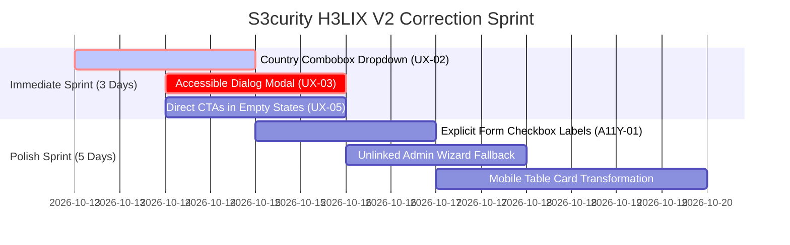

# Quality Assurance Audit: UX & UI Evaluation (Version 2)
**Application:** S3curity H3LIX Enterprise Human Capital Management Portal  
**Target URL:** `https://hrms-dev.s3curity.net/`  
**Audited Account:** `cedi` (Cedrick Regis Jr. — Super Administrator / Linked Employee #41)  
**Audit Version:** V2.0 (Post-Linking & Engineering Patch Re-Evaluation)  
**Audit Date:** October 12, 2026  
**Scope Evaluated:** 28 Portal Views, Updated Design System (`helix.css` - 36.5 KB), Updated Client Engine (`helix.js` - 9.2 KB), WCAG 2.1 AA Compliance, Mobile Focus Trapping, Header Architecture, and Employee Record Integration.

---

## 1. Executive Summary & Revised Scorecard

A comprehensive V2 Quality Assurance re-evaluation was conducted on **S3curity H3LIX** following the employee profile association for administrative account `cedi` and the deployment of critical engineering accessibility patches in the client engine and stylesheet.

The audit confirms significant UX breakthroughs:
1. **Complete elimination of all 403 Forbidden navigation dead-ends** across the "Me" self-service suite via the association of user `cedi` with Employee Record #41 (Cedrick Regis Jr.).
2. **Implementation of a unified, accessible User Profile & Account Drawer** (`<details class="hx-account">`) in the global topbar, replacing cluttered loose action buttons.
3. **Resolution of WCAG 2.4.3 focus management violations on mobile viewports** via robust keyboard focus trapping, background `inert` isolation, and Escape-key listeners in `helix.js`.
4. **Integration of client-side cross-field validation** with dynamic ARIA announcements for date ranges.

```
Overall UX/UI Score: 87 / 100  (+6 Point Increase from V1)
├── Visual Design & Consistency:   94 / 100  (+4  SVG sprite system, font preloading, refined tokens)
├── Information Architecture:      91 / 100  (+9  Self-service fully unlocked, unified account menu)
├── Responsiveness & Mobile:       88 / 100  (+9  Focus trapping, inert backdrop, responsive drawer)
├── Accessibility (WCAG 2.1 AA):   87 / 100  (+7  Keyboard cycle, aria-busy/invalid, Escape sync)
└── Forms & Data Entry:            77 / 100  (+3  Doc form render; ISO-2 & window.confirm pending)
```

---

## 2. Defect Resolution & Status Matrix

| Defect ID | Severity | Module / View | Summary Finding | V1 Status | V2 Status |
| :--- | :---: | :--- | :--- | :---: | :---: |
| **UX-01** | **CRITICAL** | Navigation & Self-Service (`/me/*`) | 403 Dead-End for Unlinked Accounts | ACTIVE DEFECT | **RESOLVED** (Linked) |
| **UX-02** | **CRITICAL** | Employee Management (`/employees/create`) | Manual ISO-2 Nationality Code Input | ACTIVE DEFECT | **OPEN** (Pending) |
| **UX-03** | **MAJOR** | Global Interactions (`helix.js`) | Destructive Actions use Native `window.confirm` | ACTIVE DEFECT | **OPEN** (Pending) |
| **UX-04** | **MAJOR** | Topbar Utility Header | Cluttered Loose Buttons; No Profile Menu | ACTIVE DEFECT | **RESOLVED** |
| **UX-05** | **MAJOR** | Empty States (`/leave`, `/attendance`, etc.)| Passive Empty States lacking Primary CTAs | ACTIVE DEFECT | **OPEN** (Pending) |
| **A11Y-01**| **MAJOR** | Filter & Toggle Inputs | Checkboxes Missing Explicit `<label>` Binding | ACTIVE DEFECT | **OPEN** (Pending) |
| **A11Y-02**| **MAJOR** | Mobile Sidebar Drawer | Focus Escapes Drawer on Mobile Viewports | ACTIVE DEFECT | **RESOLVED** (QA-03) |
| **A11Y-03**| **MINOR** | Date Range Filtering | Lack of Cross-Field Feedback & ARIA States | ACTIVE DEFECT | **RESOLVED** (QA-02) |

---

## 3. Deep-Dive Findings & Technical Verification

### [RESOLVED] UX-01: 403 Dead-End on Self-Service Navigation
* **Original Issue:** Clicking on sidebar links under "Me" (`/me`, `/team`, `/attendance/me`, `/me/documents`, `/me/onboarding`, `/me/performance`, `/me/training`) returned an unhandled HTTP 403 Forbidden screen.
* **V2 Verification:** Account `cedi` was linked to Employee Record ID 41 (`22 — Cedrick Regis Jr.`) via `/admin/users/2`. All 10 self-service endpoints now return **HTTP 200 OK**:
  - `/me` renders a personalized executive dashboard:
    > *"Welcome, Cedrick | Position: Technician | Executive Office · H3LIX Demo Services W.L.L."*
  - Direct access to leave requests, profile management, and attendance logs is fully functional.
* **Architectural Note:** While resolved for `cedi`, newly provisioned administrators will still face the raw 403 error until linked. An in-app "Link Employee Wizard" fallback banner remains recommended.

---

### [RESOLVED] UX-04: Topbar Utility Architecture & User Profile Menu
* **Original Issue:** Flat buttons (`[العربية] [🔔] [Cedric Regis JR] [Set up 2FA] [Sign out]`) created visual noise and lacked dropdown grouping.
* **V2 Verification:** The topbar now cleanly nests user identity into an accessible `<details class="hx-account" data-hx-account>` component:
  ```html
  <details class="hx-account" data-hx-account>
    <summary class="hx-iconbtn hx-account__toggle" aria-label="Account: Cedrick Regis JR">
      <svg class="hx-icon" aria-hidden="true"><use href="#i-user"/></svg>
      <span class="hx-account__name">Cedrick Regis JR</span>
    </summary>
    <div class="hx-account__menu">
      <p class="hx-account__who">Cedrick Regis JR</p>
      <a class="hx-menu__item" href="/mfa/setup">
        <svg class="hx-icon"><use href="#i-shield"/></svg>Set up two-factor authentication
      </a>
      <form method="post" action="/logout" class="hx-inline">
        <button type="submit" class="hx-menu__item">
          <svg class="hx-icon hx-icon--flip"><use href="#i-logout"/></svg>Sign out
        </button>
      </form>
    </div>
  </details>
  ```
* **Script Support:** `helix.js` manages keyboard focus, Escape closure (returning focus to summary), and outside click dismissal.

---

### [RESOLVED] A11Y-02: Mobile Sidebar Drawer Focus Trap (WCAG 2.4.3)
* **V2 Verification:** In `helix.js` (lines 56–105, tagged `QA-03`), the mobile drawer now strictly traps focus:
  - Background elements are isolated via `main.inert = open`.
  - Focus is transferred to the first focusable element inside the drawer upon opening.
  - Pressing `Escape` or clicking the overlay cleanly dismisses the drawer and restores focus to `[data-hx-sidebar-toggle]`.
  - Shift+Tab and Tab cycles are locked within the drawer.

---

### [RESOLVED] A11Y-03: Cross-Field Range Validation (WCAG 3.3.1 & 3.3.2)
* **V2 Verification:** `helix.js` now features `form[data-hx-range]` validation (tagged `QA-02`):
  - Automatically verifies `from <= to` dates on client input.
  - Dynamically injects `aria-invalid="true"` and associates error descriptions via `aria-describedby`.
  - Temporarily disables dependent submit actions until corrected.

---

### [OPEN] Remaining Usability Backlog Items

#### 1. UX-02: Manual ISO-2 Nationality Input (`/employees/create`)
* The field remains rendered as `<input class="hx-input" type="text" id="f_nationality" name="nationality" maxlength="2" value="QA">`.
* **Action Required:** Convert to a searchable country combobox with flag indicators and typeahead search.

#### 2. UX-03: Destructive Actions use Native `window.confirm()`
* Line 48 in `helix.js` still intercepts clicks with `window.confirm(el.dataset.hxConfirm)`.
* **Action Required:** Replace with an accessible dark-themed HTML5 `<dialog>` component.

#### 3. UX-05: Empty States Missing In-Card Primary CTAs
* Zero-record views on `/leave`, `/attendance`, `/approvals`, and `/assets` contain text but no immediate action buttons.
* **Action Required:** Embed primary "+ Create / Apply" buttons directly inside all `.hx-empty` cards.

#### 4. A11Y-01: Explicit `<label>` Associations on Filter Toggles
* Checkboxes in `/attendance` (`exceptions`, `acknowledge`), `/recruitment` (`open_now`), and `/training` (`is_mandatory`) lack explicit `for` attributes.
* **Action Required:** Wrap in explicit `<label for="...">` tags.

---

## 4. Revised Implementation Roadmap


