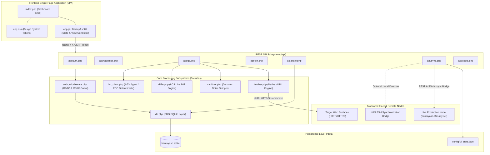
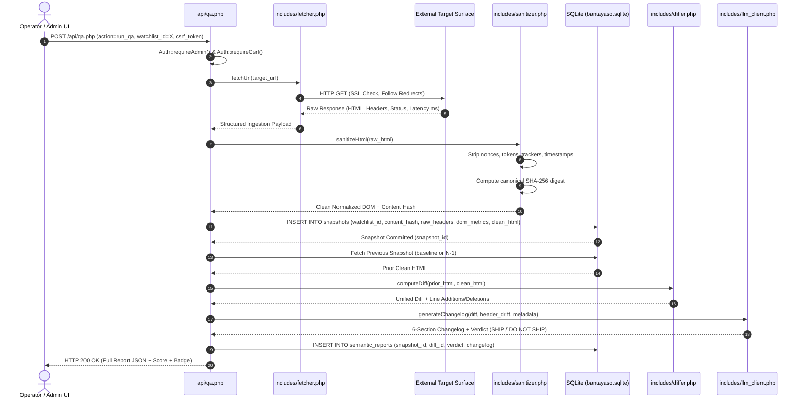

# Bantay Aso — System Architecture & Engineering Specification

> **Audience:** Software Engineers, DevOps / SRE, Security Architects, and Systems Administrators.  
> **Platform Version:** 1.2.0 (`CyberHound`)  
> **Target Environment:** Standard Linux Virtualmin VPS (LAMP / LEMP) & Local Mirror  

---

## 1. Executive Architecture Summary

**Bantay Aso** (*Tagalog for "Guard Dog" / "Watchdog"*) is a web-native, deterministic Quality Assurance (QA), visual regression tracking, security posture audit, and semantic changelog generation platform. 

The system operates under **Strict VPS Hosting Constraints**:
1. **Pure Web-Native Execution:** Written in vanilla PHP 8.x, ES6+ JavaScript, and standards-compliant CSS3/HTML5.
2. **Zero Shell Dependencies in Core Paths:** Core ingestion, sanitization, diffing, and reporting require zero server-side shell execution (`exec()`, `shell_exec()`, `passthru()`), ensuring compatibility with locked-down shared and VPS hosting environments.
3. **Zero Build Step:** Native drop-in deployment without Node/Composer runtime build pipelines on production.
4. **Relational SQLite Persistence:** Self-initializing SQLite3 storage with WAL (Write-Ahead Logging) mode and Apache/Nginx directory isolation.

---

## 2. High-Level Architectural Diagram

---

## 3. Module Responsibilities ("What Stuff Does What")

### 3.1 Presentation & Client Controller Layer
| Component | File Path | Primary Responsibilities |
| :--- | :--- | :--- |
| **Dashboard Shell** | [`index.php`](file:///c:/Cedi/bantayaso/index.php) | Pre-renders initial HTML shell, primary navigation tabs (Watchlist, Security Hub, Sync Tools), dynamic server-side session badges, and modal structures for diffs and QA reports. |
| **Frontend Controller** | [`app.js`](file:///c:/Cedi/bantayaso/app.js) / [`assets/js/app.js`](file:///c:/Cedi/bantayaso/assets/js/app.js) | Central reactive store (`App.state`), tab switching (`BantayAsoUI.switchView`), CSRF token lifecycle, optimistic UI updates, toast notifications, and modal orchestration. |
| **Design System** | [`app.css`](file:///c:/Cedi/bantayaso/app.css) / [`assets/css/app.css`](file:///c:/Cedi/bantayaso/assets/css/app.css) | Midnight obsidian design system tokens, typography (`Plus Jakarta Sans` + `JetBrains Mono`), responsive table breakpoints, and status pill colors. |
| **Authentication Views** | [`login.php`](file:///c:/Cedi/bantayaso/login.php), [`change-password.php`](file:///c:/Cedi/bantayaso/change-password.php) | Standalone sign-in and credential rotation views with Argon2id hash enforcement. |

### 3.2 Core Processing Engines (`includes/`)
| Subsystem | File Path | Technical Operation |
| :--- | :--- | :--- |
| **Global Configuration** | [`config.php`](file:///c:/Cedi/bantayaso/config.php) | Parses `.env` key-values into `$_ENV`/`$_SERVER`, enforces secure cookie directives (`SameSite=None/Lax`, `Secure`, `HttpOnly`), initializes database path constants, and applies PHP2Shell multipart request mitigations. |
| **Database Gateway** | [`includes/db.php`](file:///c:/Cedi/bantayaso/includes/db.php) | Establishes persistent PDO SQLite connection (`SQLITE_FILE`), executes declarative auto-migration DDL for tables (`watchlist`, `snapshots`, `diffs`, `semantic_reports`, `incidents`, `users`), and seeds baseline admin accounts. |
| **Auth & Security Middleware** | [`includes/auth_middleware.php`](file:///c:/Cedi/bantayaso/includes/auth_middleware.php) | Validates session state, checks RBAC roles (`admin` vs `viewer`), manages cryptographic session CSRF tokens (`X-CSRF-Token`), and hashes passwords using Argon2id (`PASSWORD_ARGON2ID`). |
| **Web Crawler / Ingestion** | [`includes/fetcher.php`](file:///c:/Cedi/bantayaso/includes/fetcher.php) | Issues native PHP cURL requests, follows redirects (up to 5 hops), captures SSL handshake validity, measures round-trip latency in milliseconds, and extracts raw HTTP response headers. |
| **Content Sanitizer** | [`includes/sanitizer.php`](file:///c:/Cedi/bantayaso/includes/sanitizer.php) | Implements ECC noise-reduction directives: strips dynamic script nonces (`nonce="..."`), inline anti-CSRF tokens, dynamic timestamps, tracking pixels (Google Analytics, GTM, Hotjar), and computes canonical SHA-256 DOM hash. |
| **Line Diff Engine** | [`includes/differ.php`](file:///c:/Cedi/bantayaso/includes/differ.php) | Computes line-by-line differences using the Longest Common Subsequence (LCS) algorithm; formats diff outputs into both standard unified diff (`patch` format) and side-by-side colorized HTML tables. |
| **Semantic AI Client** | [`includes/llm_client.php`](file:///c:/Cedi/bantayaso/includes/llm_client.php) | Bridges diff inputs and security telemetry to an LLM provider (Antigravity Agent / AGY CLI sidecar or zero-infrastructure ECC deterministic rules) to synthesize structured 6-section Semantic Changelogs. |

### 3.3 API Routing Layer (`api/`)
| Endpoint | Method | Role Required | Functionality |
| :--- | :---: | :---: | :--- |
| **`/api/auth.php`** | `GET / POST` | Public / Session | Authenticates users (`action=login`), clears session (`action=logout`), and distributes valid CSRF tokens (`action=me`). |
| **`/api/watchlist.php`** | `GET / POST` | Viewer (Read) / Admin (Write) | Lists active monitored websites, validates URL schemas, adds new targets, and archives/deletes target rows. |
| **`/api/qa.php`** | `GET / POST` | Viewer (Read) / Admin (Run) | Executes the synchronous 4-step QA pipeline for a target or retrieves historical snapshot metadata and report cards. |
| **`/api/diff.php`** | `GET` | Viewer | Computes or retrieves stored LCS unified diffs and semantic changelog reports between two snapshot IDs. |
| **`/api/state.php`** | `GET` | Viewer | Returns platform telemetry: total targets, snapshot counts, fleet security grades, average latency, and recent incidents. |
| **`/api/sync.php`** | `GET / POST` | Viewer (Status) / Admin (Sync) | Orchestrates two-way lockstep synchronization with the live production node (`https://bantayaso.s3curity.net`). |
| **`/api/users.php`** | `GET / POST` | Admin Only | Administrative user management (create account, set role, delete user). |
| **`/api/settings.php`**| `GET / POST` | Admin Only | Configures LLM analysis mode (`gemini_cli`, `antigravity_agent`, or `ecc_deterministic`), endpoint URLs, and timeouts. |

---

## 4. System Data Flow ("What Goes Where")

### 4.1 Synchronous "NEW QA" Pipeline Flow
The primary workflow triggered when an authorized operator initiates an inspection:

### 4.2 Security Sentinel & Telemetry Flow
1. **Header Audit:** During step 1 of the QA pipeline, `fetcher.php` parses response headers for mandatory security controls:
   - `Content-Security-Policy` (CSP)
   - `Strict-Transport-Security` (HSTS)
   - `X-Frame-Options` (Clickjacking defense)
   - `X-Content-Type-Options` (MIME sniffing defense)
   - `Referrer-Policy` & `Permissions-Policy`
2. **Grade Calculation:** Security scores (0–100) and letter grades (`A+` to `F`) are derived from missing security headers, mixed content flags, and cookie attribute hygiene (`SameSite`, `HttpOnly`, `Secure`).
3. **Telemetry Aggregation:** `/api/state.php` computes fleet-wide averages and populates the KPI metrics rendered in the Security Hub dashboard.

### 4.3 Bidirectional Synchronization Flow
Maintains parity between local development instances and the live production node (`https://bantayaso.s3curity.net`):
1. **Trigger:** Admin clicks `#btnSyncOnline` in the UI or invokes `/api/sync.php?action=sync`.
2. **Environment Evaluation:**
   - **On Live Node (`bantayaso.s3curity.net`):** Acts as the primary authority; executes dry-run validation and records lockstep confirmation (0 bytes drift).
   - **On Local Node:** Invokes `sync_online.py` or SSH rsync bridge (`sync.ps1` / `sync.sh`) to exchange watchlist updates, snapshot diffs, and updated `config/ui_state.json`.
3. **State Convergence:** Local database records are reconciled against remote production records, ensuring identical target tracking across nodes.

---

## 5. Security Posture & Hardening Directives

1. **CSRF Neutralization:** Double-submit / session-bound anti-CSRF token verification on all mutation operations (`POST`, `PUT`, `DELETE`).
2. **PHP2Shell / Parser Attack Defenses (CVE-2026-109618 / CVE-2026-109619):**
   - Immediate HTTP 415 rejection of unexpected `multipart/form-data` requests in `config.php`.
   - Disabled `session.upload_progress.enabled` to eliminate arbitrary file write paths.
   - Disabled `fatal_error_backtraces` in production to prevent stack trace information disclosure.
3. **Data Directory Isolation:** `data/` directory is hardened with `.htaccess` (`Require all denied` / `Deny from all`) preventing direct URL access to `bantayaso.sqlite`.
4. **Credential Cryptography:** Password storage leverages native `PASSWORD_ARGON2ID` with configured memory, time, and parallelism costs. Zero plaintext credentials persisted in code.
